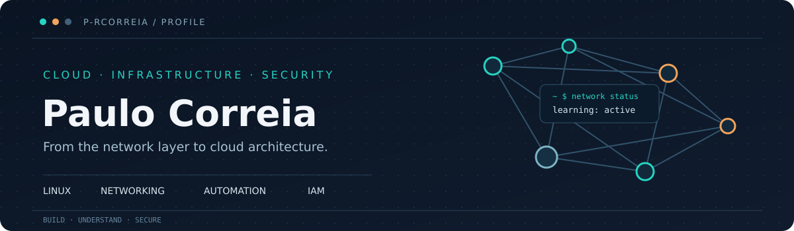
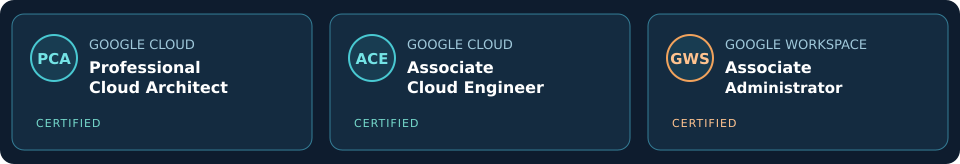

  

  <a href="#sobre">Sobre</a> &nbsp;·&nbsp;
  <a href="#foco-atual">Foco atual</a> &nbsp;·&nbsp;
  <a href="#projetos-e-estudos">Projetos</a> &nbsp;·&nbsp;
  <a href="#certificações">Certificações</a> &nbsp;·&nbsp;
  <a href="#contato">Contato</a>

## Sobre

Atuo como **Cloud & Infrastructure Analyst** na WH1 Cloud, trabalhando com ambientes corporativos, administração de serviços, troubleshooting, integrações, automações e soluções de IA.

Atualmente aprofundo meus estudos em **cibersegurança, redes e Linux** para compreender melhor como sistemas, identidades, protocolos e serviços se conectam — da infraestrutura à aplicação. Tenho uma base em **Java, Spring Boot, APIs e bancos de dados**, que continua sendo parte da minha formação.

> Mais do que operar ferramentas, quero entender por que cada tecnologia existe, que problema resolve e como suas decisões impactam o ambiente.

## Foco atual

<table>
<tr><td width="50%"><b>☁️ Cloud &amp; Architecture</b> Google Cloud, AWS, IAM, DNS, storage e arquitetura</td><td width="50%"><b>🛡️ Cybersecurity &amp; Networking</b> Protocolos, Linux, análise de tráfego, controle de acesso e laboratórios isolados</td></tr>
<tr><td><b>⚙️ Infrastructure &amp; Automation</b> Servidores, HTTPS/TLS, CI/CD, troubleshooting e deploy</td><td><b>💻 Software Engineering</b> Java, Spring Boot, APIs e bancos de dados como base complementar</td></tr>
</table>

## Experiência

**Cloud & Infrastructure Analyst — WH1 Cloud** · desde agosto de 2024

- Implantação e administração de ambientes Google Workspace e serviços de nuvem.
- Troubleshooting, suporte técnico e integração de soluções empresariais.
- Automação e apoio técnico ao desenvolvimento, à avaliação e ao aprimoramento de agentes de IA generativa.

*Projetos, dados e detalhes de clientes não são expostos por confidencialidade.*

## Projetos e estudos

| Repositório | O que realmente representa |
| --- | --- |
| [Java Backend Developer Roadmap 2026](https://github.com/p-rcorreia/java-backend-developer-roadmap-2026) | Aplicação desenvolvida em Vue/TypeScript e Docker para organizar estudos; não implica domínio dos 126 tópicos catalogados |
| [Fundamentos Java](https://github.com/p-rcorreia/fundamentos-java) | Exercícios e material de estudo, com diferentes níveis de conclusão por módulo |
| [Software Design Studies](https://github.com/p-rcorreia/software-design-studies) | Registros e estrutura de estudos anteriores em arquitetura de software; não é uma trilha concluída |
| Cloud Levels | Laboratórios de Cloud e infraestrutura; parte da documentação ainda é privada |

## Certificações

<b>Google Cloud · Google Workspace · AWS</b>

<table>
<tr>
<td align="center" width="25%"> <b>Professional Google Workspace Administrator</b></td>
<td align="center" width="25%"> <b>Cloud Digital Leader</b></td>
<td align="center" width="25%"> <b>Generative AI Leader</b></td>
<td align="center" width="25%"> <b>AWS Cloud Practitioner</b></td>
</tr>
</table>

  

**Formação complementar:** Google Cybersecurity Professional Certificate (programa de cursos) e Cisco Networking Basics.

**Graduação:** Bacharelado em Ciência da Computação — Cruzeiro do Sul Virtual, em andamento.

## Como estudo

**Conceito → prática → evidência → aprendizado.** Meus repositórios registram etapas distintas dessa trajetória. Não confundo um roadmap com experiência concluída, e não publico dados de ambientes de clientes.

## Contato

[LinkedIn](https://www.linkedin.com/in/paulo-ricardo-correia-533b35244/) · [GitHub](https://github.com/p-rcorreia) · [E-mail](mailto:paulojavase@gmail.com)
