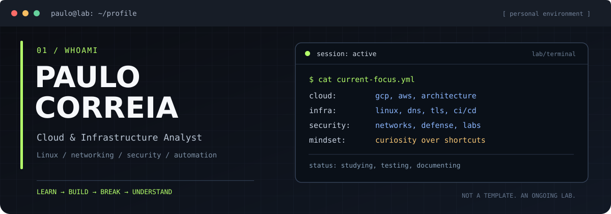
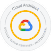
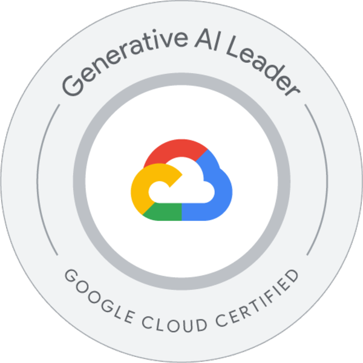

<p align="center">
  
</p>

<p align="center">
  <a href="#de-java-ao-laboratório">TRAJETÓRIA</a> &nbsp; / &nbsp;
  <a href="#o-que-já-coloquei-de-pé">NA PRÁTICA</a> &nbsp; / &nbsp;
  <a href="#o-que-estou-investigando">EM EXPLORAÇÃO</a> &nbsp; / &nbsp;
  <a href="#projetos-e-repositórios">REPOSITÓRIOS</a> &nbsp; / &nbsp;
  <a href="#certificações">CERTIFICAÇÕES</a>
</p>

---

## De Java ao laboratório

Comecei mergulhando em **Java, backend e arquitetura de software**. No caminho, a pergunta deixou de ser só *“como desenvolver isso?”* e virou **“o que precisa acontecer para isso funcionar de verdade — e de forma segura?”**

Foi assim que fui cada vez mais fundo em **Cloud, Linux, redes, identidade, DNS, TLS, automação e segurança**. Hoje, quero enxergar o sistema inteiro: o pacote que sai da máquina, o serviço que recebe a requisição, as permissões envolvidas, a aplicação por trás e o que pode dar errado no caminho.

**Não abandonei o código.** Java, Spring Boot, APIs e bancos de dados continuam fazendo parte da minha caixa de ferramentas. Só ampliei o mapa.

## O que já coloquei de pé

<sub>01 / EXPERIÊNCIA NA PRÁTICA</sub>

### ☁️ Cloud, DNS e distribuição

Publiquei meu site com **Amazon S3 + CloudFront**, configurei certificado TLS no **ACM** e DNS no **Route 53**, colocando o domínio principal e o `www` para funcionar. O que parecia só “colocar uma página no ar” virou um laboratório sobre CDN, HTTPS e resolução de nomes.

### ⚙️ Servidores, Linux e automação

Venho explorando **Linux, servidores web, HTTPS e pipelines com GitHub Actions**. Gosto de seguir uma implantação de ponta a ponta: entender a configuração, testar, encontrar o erro e descobrir como corrigir.

### 🧠 Inteligência artificial aplicada

Trabalhei com **agentes corporativos de IA generativa**, participando da construção, avaliação e melhoria de respostas, instruções e integrações. São problemas reais, com aprendizados reais — sem expor informações de clientes.

### 💻 Software que também faz parte da história

Passei por **Java, Spring Boot, APIs e bancos de dados** e construí uma aplicação em **Vue + TypeScript + Docker** para acompanhar meus estudos. Essa base me ajuda a investigar a infraestrutura pelo lado de quem desenvolve.

## O que estou investigando

**Agora a curiosidade está nas camadas que sustentam tudo isso:** redes e cibersegurança.

- **Networking:** TCP/IP, ARP, MAC, ICMP, TCP, HTTP, switching e observação do tráfego no Cisco Packet Tracer.
- **Sistemas e segurança:** Linux, permissões, serviços, identidade, superfície de ataque e análise de conexões.
- **Cloud e arquitetura:** decisões de arquitetura em Google Cloud e AWS, IAM, redes, armazenamento, logging e disponibilidade.
- **Próximas explorações:** aprofundar laboratórios de segurança em ambientes isolados, containers e Kubernetes.

Não confundo **estudar um assunto** com **dominar o assunto**. Mas também não quero que meu perfil seja só uma lista de coisas que ainda pretendo fazer.

```text
paulo@lab:~$ trace learning-path
java/backend -> cloud/infra -> networks -> cybersecurity
                 |                 |
                 +-- build labs ---+-- investigate failures
```

## Projetos e repositórios

<sub>02 / CÓDIGO, EXPERIMENTOS E ANOTAÇÕES</sub>

**Cloud Levels** · *laboratórios pessoais*  
Experimentação de infraestrutura em Cloud. Parte do código e das evidências ainda está em repositórios privados.

**[Java Backend Roadmap App](https://github.com/p-rcorreia/java-backend-developer-roadmap-2026)** · *aplicação funcional*  
Um painel que construí com Vue, TypeScript e Docker para organizar estudos. O software existe; isso não significa que todos os tópicos do roadmap foram concluídos.

**[Fundamentos Java](https://github.com/p-rcorreia/fundamentos-java)** · *arquivo de aprendizado*  
Pequenos projetos, exercícios e registros que mostram etapas da minha base em programação.

**[Software Design Studies](https://github.com/p-rcorreia/software-design-studies)** · *estudos em andamento*  
Notas e estrutura de estudos sobre design e arquitetura de software, sem fingir que o conteúdo já está completo.

## Experiência profissional

**WH1 Cloud · Cloud & Infrastructure Analyst** — desde agosto de 2024

Atuação com ambientes corporativos, Google Workspace, suporte avançado, administração de serviços, troubleshooting, automações, integrações e soluções de IA generativa. Essa experiência é parte da minha trajetória — **não o limite do que estudo e construo**.

<sub>Informações, ambientes e projetos de clientes são mantidos em sigilo.</sub>

## Certificações

<p align="center"><b>7 certificações · Google Cloud · Google Workspace · AWS</b></p>

<table align="center">
  <tr>
    <td align="center" width="25%"><br/><sub><b>Professional Cloud Architect</b></sub></td>
    <td align="center" width="25%"><br/><sub><b>Associate Cloud Engineer</b></sub></td>
    <td align="center" width="25%"><br/><sub><b>Cloud Digital Leader</b></sub></td>
    <td align="center" width="25%"><br/><sub><b>Generative AI Leader</b></sub></td>
  </tr>
  <tr>
    <td align="center"><br/><sub><b>Professional Google Workspace Administrator</b></sub></td>
    <td align="center"><br/><sub><b>Associate Google Workspace Administrator</b></sub></td>
    <td align="center"><br/><sub><b>AWS Certified Cloud Practitioner</b></sub></td>
    <td align="center"><a href="https://www.credly.com/users/paulo-ricardo-correia"><b>Verificar minhas certificações ↗</b></a><br/><sub>Badges e credenciais no Credly</sub></td>
  </tr>
</table>

**Formação complementar:** Google Cybersecurity Professional Certificate (programa de cursos) e Cisco Networking Basics.

**Graduação:** Bacharelado em Ciência da Computação — Cruzeiro do Sul Virtual, em andamento.


## Contato

<p align="center">
<a href="https://www.linkedin.com/in/paulo-ricardo-correia-533b35244/">LinkedIn</a> &nbsp;·&nbsp;
<a href="https://www.credly.com/users/paulo-ricardo-correia">Credly</a> &nbsp;·&nbsp;
<a href="mailto:paulojavase@gmail.com">E-mail</a>
</p>

<p align="center"><sub>O próximo experimento sempre começa com uma pergunta.</sub></p>
