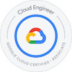
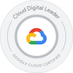
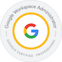
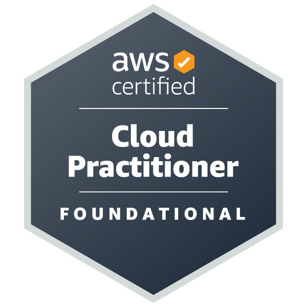

<p align="center">
  
</p>

<p align="center">
  <a href="#sobre">SOBRE</a> &nbsp; / &nbsp;
  <a href="#lab-status">LAB STATUS</a> &nbsp; / &nbsp;
  <a href="#experiência">EXPERIÊNCIA</a> &nbsp; / &nbsp;
  <a href="#projetos--estudos">PROJETOS</a> &nbsp; / &nbsp;
  <a href="#certificações">BADGES</a>
</p>

---

## Sobre

Não quero apenas saber **qual comando executar**. Quero entender o que acontece **antes, durante e depois** dele.

Sou **Cloud & Infrastructure Analyst na WH1 Cloud**, com atuação em ambientes corporativos, Google Workspace, troubleshooting, automação, integrações e soluções de inteligência artificial. Fora da rotina profissional, estudo **redes, Linux e cibersegurança**, conectando conceitos com laboratórios práticos.

Minha base em **Java, Spring Boot, APIs e bancos de dados** continua presente — especialmente para entender a infraestrutura também pelo ponto de vista das aplicações.

> **A curiosidade é o ponto de partida. O laboratório é onde o conhecimento ganha forma.**

## Lab status

<table>
<tr>
<td width="50%" valign="top">
<b>01 · CLOUD / ARCHITECTURE</b><br/>
<sub>Google Cloud, AWS, IAM, DNS, storage, decisões de arquitetura e disponibilidade.</sub>
</td>
<td width="50%" valign="top">
<b>02 · NETWORK / SECURITY</b><br/>
<sub>TCP/IP, switching, endereçamento, análise de protocolos, controle de acesso e fundamentos de segurança.</sub>
</td>
</tr>
<tr>
<td valign="top">
<b>03 · SYSTEMS / AUTOMATION</b><br/>
<sub>Linux, servidores web, TLS, troubleshooting, GitHub Actions e automação de deploy.</sub>
</td>
<td valign="top">
<b>04 · SOFTWARE / FOUNDATIONS</b><br/>
<sub>Java, Spring Boot, APIs, SQL e design de software — uma base que complementa infraestrutura.</sub>
</td>
</tr>
</table>

```text
$ ./learning-loop
  [01] entender o conceito
  [02] reproduzir no laboratório
  [03] investigar o que falhou
  [04] documentar a descoberta
  status: in progress
```

## Experiência

**Cloud & Infrastructure Analyst · WH1 Cloud**  
*Desde agosto de 2024*

- Administração e implantação de ambientes corporativos de Google Workspace e serviços de nuvem.
- Investigação de incidentes, troubleshooting e suporte técnico.
- Apoio a automações, integrações e avaliação e aprimoramento de soluções de IA generativa.

<sub>Projetos e informações de clientes são preservados por confidencialidade.</sub>

## Projetos & estudos

<table>
<tr><th>Repositório</th><th>O que você encontra</th></tr>
<tr><td><a href="https://github.com/p-rcorreia/java-backend-developer-roadmap-2026"><b>Java Roadmap App</b></a></td><td>Aplicação em Vue/TypeScript e Docker para organização de estudos. O catálogo de tópicos não representa conclusão de toda a trilha.</td></tr>
<tr><td><a href="https://github.com/p-rcorreia/fundamentos-java"><b>Fundamentos Java</b></a></td><td>Exercícios e registros de aprendizado em programação, com conteúdos em diferentes estágios.</td></tr>
<tr><td><a href="https://github.com/p-rcorreia/software-design-studies"><b>Software Design Studies</b></a></td><td>Registros e estrutura dos estudos de arquitetura de software, ainda não concluídos.</td></tr>
<tr><td><b>Cloud Levels</b></td><td>Laboratórios pessoais de infraestrutura e Cloud, com documentação parcialmente privada.</td></tr>
</table>

## Certificações

<p align="center"><b>7 certificações · Google Cloud · Google Workspace · AWS</b></p>

<table align="center">
  <tr>
    <td align="center" width="25%"><br/><sub><b>Professional Cloud Architect</b></sub></td>
    <td align="center" width="25%"><br/><sub><b>Associate Cloud Engineer</b></sub></td>
    <td align="center" width="25%"><br/><sub><b>Cloud Digital Leader</b></sub></td>
    <td align="center" width="25%"><br/><sub><b>Generative AI Leader</b></sub></td>
  </tr>
  <tr>
    <td align="center"><br/><sub><b>Professional Google Workspace Administrator</b></sub></td>
    <td align="center"><br/><sub><b>Associate Google Workspace Administrator</b></sub></td>
    <td align="center"><br/><sub><b>AWS Certified Cloud Practitioner</b></sub></td>
    <td align="center"><a href="https://www.credly.com/users/paulo-ricardo-correia"><b>Verificar minhas certificações ↗</b></a><br/><sub>Badges e credenciais no Credly</sub></td>
  </tr>
</table>

**Formação complementar:** Google Cybersecurity Professional Certificate (programa de cursos) e Cisco Networking Basics.

**Graduação:** Bacharelado em Ciência da Computação — Cruzeiro do Sul Virtual, em andamento.


## Contato

<p align="center">
<a href="https://www.linkedin.com/in/paulo-ricardo-correia-533b35244/">LinkedIn</a> &nbsp;·&nbsp;
<a href="https://www.credly.com/users/paulo-ricardo-correia">Credly</a> &nbsp;·&nbsp;
<a href="mailto:paulojavase@gmail.com">E-mail</a>
</p>

<p align="center"><sub>Built with curiosity. Maintained with evidence.</sub></p>
